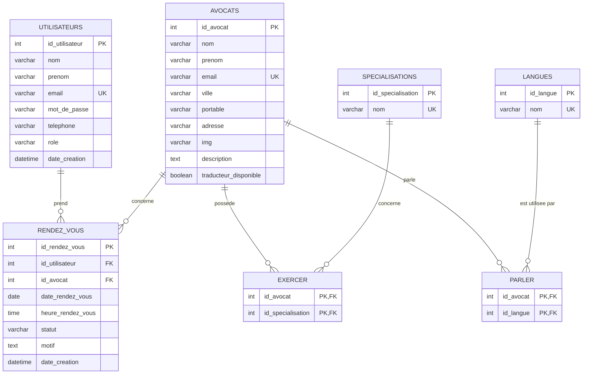

# LegalBridge ⚖️

LegalBridge est une application web développée pour aider les personnes étrangères en France à trouver plus facilement un avocat et à prendre rendez-vous selon leur besoin juridique.

## Fonctionnalités

- Inscription et connexion utilisateur
- Authentification avec JWT
- Consultation des avocats
- Prise de rendez-vous
- Consultation de ses rendez-vous
- Espace administrateur
- Ajout, modification et suppression des avocats
- Gestion du statut des rendez-vous

## Technologies utilisées

### Frontend

- Angular
- TypeScript
- HTML
- CSS

### Backend

- Node.js
- Express.js
- API REST
- JWT
- bcrypt

### Base de données

- SQL
- MySQL

### Outils

- Git
- GitHub
- Postman
- Jest
- Visual Studio Code

## Modèle de la base de données

La base de données de LegalBridge est composée de 7 tables :

- `utilisateurs` : stocke les informations des utilisateurs et leurs rôles.
- `avocats` : contient les informations des avocats.
- `rendez_vous` : gère les rendez-vous entre les utilisateurs et les avocats.
- `specialisations` : contient les domaines de spécialisation juridique.
- `exercer` : table de liaison entre les avocats et leurs spécialisations.
- `langues` : contient les langues disponibles.
- `parler` : table de liaison entre les avocats et les langues qu'ils parlent.

### Diagramme des relations (ERD)

## Tests

Le projet contient des tests unitaires avec Jest.

J’utilise également Postman pour tester manuellement les routes de l’API.

## Sécurité

- Hashage des mots de passe avec bcrypt
- Authentification avec JWT
- Protection des routes administrateur
- Validation des données côté serveur
- Requêtes SQL paramétrées

## Objectif du projet

Ce projet m’a permis de développer une application full-stack avec Angular, Node.js, Express et SQL, tout en travaillant sur l’authentification, les API REST, la gestion des rendez-vous et l’administration.

## Auteur

Sajjad
